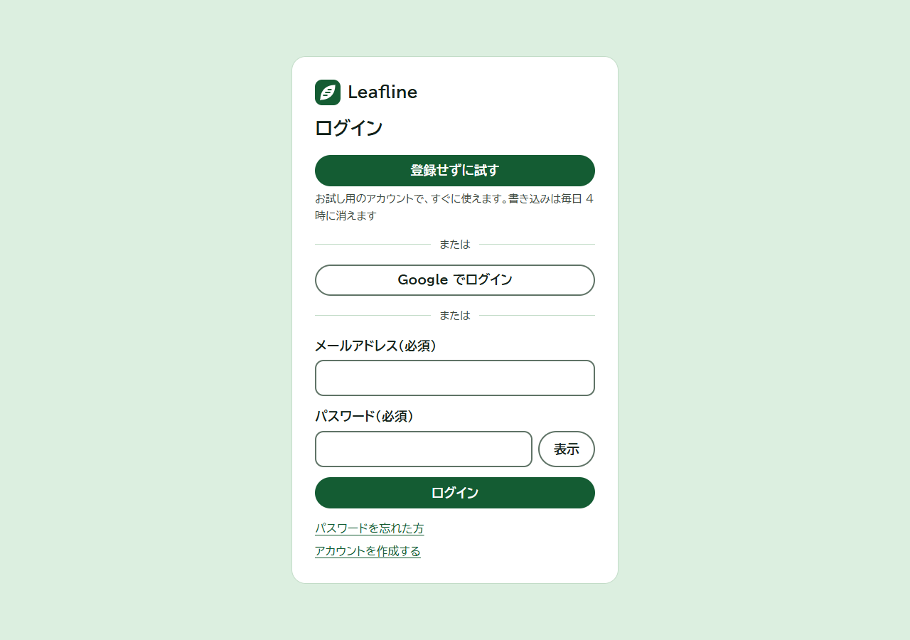
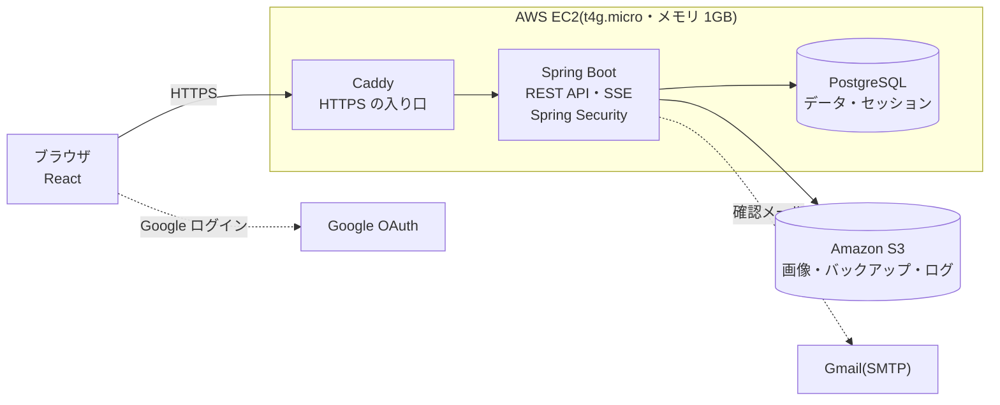

#  Leafline

**Leafline**(リーフライン)は、X(旧 Twitter)のような、タイムライン型の SNS の Web アプリです。
就職活動のポートフォリオとして、**要件定義 → 設計 → 実装 → テスト → AWS への公開 → 運用の準備**まで、ひと通り 1 人で作りました。

[](https://github.com/123tk555-gif/SNS/actions/workflows/ci.yml)


左が「たろう」、右が「はなこ」の画面です。はなこが投稿すると、たろうの画面に「新しい投稿が 1 件あります」が出て、押すと先頭に表示されます。たろうがいいねすると、はなこの通知に未読の数が付きます。どちらも再読み込みなしで届きます(Server-Sent Events)。

## 見てほしいところ

| | 何をしたか | どこを見ればわかるか |
|---|---|---|
| **1. リアルタイム** | 新着・通知・削除を、SSE で再読み込みなしに届ける。ブロックした人には届けない。新着はためて「○ 件あります」で知らせ、読んでいる一覧を勝手に動かさない | [RealtimeDispatcher.java](src/main/java/com/example/sns/realtime/RealtimeDispatcher.java)、[HomePage.jsx](frontend/src/pages/HomePage.jsx) |
| **2. 安全** | すべての API で、ログイン・本人・管理者かをサーバー側で確かめる。CSRF 対策、Cookie の属性、Content-Security-Policy、ログインの連続失敗のロック、画像は中身で形式を確かめる | [SecurityConfig.java](src/main/java/com/example/sns/security/SecurityConfig.java)、[AccessControlTest.java](src/test/java/com/example/sns/security/AccessControlTest.java) |
| **3. 性能** | 一覧を何件取っても、SQL の回数が増えない(N+1 を防ぐ)。それをテストで SQL の回数を数えて確かめている。続きはカーソル方式で読み、二重に出ない。k6 で 60 人の同時利用を測った | [PostViews.java](src/main/java/com/example/sns/post/PostViews.java)、[PostApiTest.java](src/test/java/com/example/sns/post/PostApiTest.java)、[load/README.md](load/README.md) |
| **4. テストの層** | DB を使わない単体テスト・本物の PostgreSQL での結合テスト・実際のブラウザでの操作テスト・負荷テスト。プッシュのたびに CI で流れる。不具合はテストで再現してから直した(TDD) | [ci.yml](.github/workflows/ci.yml)、[e2e/flows/](e2e/flows/) |
| **5. 運用** | テーブルの変更を番号付きの SQL で管理(Flyway)。ログは JSON で、リクエスト番号・出来事を項目付きで残す。AWS は使うときだけ起動し、毎日 S3 にバックアップ | [db/migration/](src/main/resources/db/migration/)、[RequestLogFilter.java](src/main/java/com/example/sns/logging/RequestLogFilter.java)、[deploy/aws/](deploy/aws/) |
| **6. 文書** | 要件定義書・機能定義書・画面仕様定義書・受け入れ確認表・API 仕様書をそろえ、実装と食い違ったら文書も直した | [docs/](docs/) |

設計で工夫したこと・苦労したこと・技術を選んだ理由は、[ポートフォリオ説明](docs/ポートフォリオ説明.md)にまとめています。

## 試し方

**ログイン画面の「登録せずに試す」**を押すと、登録せずに、お試し用のアカウントですぐに使えます(書き込みは毎日 4 時に消えます)。

- **公開版**: <https://yarimasunesugi.duckdns.org/>(API 仕様書は [/swagger-ui.html](https://yarimasunesugi.duckdns.org/swagger-ui.html))。費用を抑えるため、サーバーはふだん止めています。開けないときは止めている時間です。面接などでは、その場で起動してお見せできます
- **手元**: 下の「[動かし方](#動かし方開発用)」で、テストデータ入りで動かせます

## 画面

| ホーム | 投稿の詳細と返信 |
|---|---|
|  |  |
| **プロフィール** | **通知** |
|  |  |
| **トレンド(直近 24 時間のハッシュタグと人気投稿)** | **検索(日本語の文章・全角半角を区別しない)** |
|  |  |
| **ログイン(登録せずに試せる)** | **設定(ダークモード)** |
|  |  |

**画像つきの投稿と、ダークモード**: 画像は送る前にブラウザで縮小して WebP に変換します(写真の位置情報も消えます)。


**スマートフォン**(幅 375px でも、横にはみ出さずに全画面を操作できます)

<p>
  
  
  
</p>

## 主な機能

| 分類 | できること |
|---|---|
| アカウント | メール+パスワードでの登録(確認メール)、Google ログイン、**登録せずに試せるお試しログイン**、パスワードの再設定、ログインの連続失敗でのロック |
| 投稿 | 1000 文字・画像 10 枚まで。編集・削除、返信、`#ハッシュタグ`・`@メンション`・URL の自動リンク、画像の代替テキスト |
| タイムライン | 「すべて」と「フォロー中」。無限スクロール(カーソル方式)、新着はリアルタイムで届き、「新しい投稿が ○ 件あります」ボタンで表示 |
| リアクション | いいね・ブックマーク(押した瞬間に切り替わり、失敗したら元に戻る) |
| つながり | フォロー、ブロック(お互いに見えなくなる)、ミュート(自分の画面からだけ消える) |
| 通知 | いいね・返信・フォロー・メンション。未読のバッジがリアルタイムで増える |
| 探す | 投稿・ユーザー・ハッシュタグの検索、トレンド |
| 管理者 | 投稿の非表示、ユーザーの利用停止(管理者以外には、画面も API も「見つかりません」) |
| 表示 | ライト・ダーク・端末に合わせる、スマートフォン対応、キーボードだけでの操作、読み上げソフトへの配慮 |

## 技術スタック

| 層 | 使ったもの |
|---|---|
| 画面 | React 19 / Vite 8 / React Router 8 / CSS(ライブラリなし)/ oxlint |
| サーバー | Java 21 / Spring Boot 4.1(Spring Web MVC・Spring Security・Spring Data JPA・Spring Session JDBC)/ Hibernate 7 / Flyway |
| データベース | PostgreSQL 18 |
| リアルタイム | Server-Sent Events(`SseEmitter`) |
| API 仕様書 | springdoc-openapi 3.2(Swagger UI・OpenAPI 3.1) |
| テスト | JUnit 6 / Testcontainers(本物の PostgreSQL)/ Vitest / Playwright / k6 |
| 公開・運用 | Docker Compose / Caddy(HTTPS)/ AWS EC2・S3・Systems Manager / DuckDNS / GitHub Actions / Dependabot |

## 構成



- 画面(React)はビルドして、Spring Boot が配信します。開発中は Vite の開発サーバーを使います
- ログイン状態はサーバーのセッション(Cookie・データベースに保存)で持ち、データを変える操作には CSRF 対策のヘッダーを付けます
- 公開時は、画像を S3 に保存し、データベースのバックアップ(毎日)とログも S3 に送ります。秘密の値はパラメータストアに置き、サーバーには IAM ロールで最小限の権限だけを渡します(アクセスキーは作りません)

## テスト

| 何を | どうやって | 内容 |
|---|---|---|
| サーバー | `./mvnw test` | JUnit 140 件。**結合テスト**(本物の PostgreSQL を Testcontainers で動かす。Docker が必要。S3 への保存は S3Mock で確かめる)と、DB を使わない**単体テスト** |
| 画面の単体テスト | `cd frontend && npm test` | Vitest 74 件。日時の表示・本文のリンク化・表示モード・色の組み合わせの見やすさ(文字と背景の明るさの差)など |
| 画面のコード | `cd frontend && npm run lint` | oxlint |
| 画面の操作 | `cd e2e && npm install && npm test` | Playwright で実際のブラウザ(Edge)を動かす。11 本・234 項目 |
| 見やすさの点検 | `cd e2e && npm run audit` | 全画面を 375px/1280px・ライト/ダークで開き、横スクロール・名前のない部品・フォーカスの枠などを調べる |
| 負荷テスト | [load/README.md](load/README.md) の手順 | k6 で、本番に近づけた手元の構成に 30〜60 人ぶんの操作を流す(本番の AWS には流さない) |

- **CI(GitHub Actions)**: プッシュのたびに、サーバーのテストと画面の lint・単体テスト・ビルドが流れます。main へのプッシュでは、画面の操作テストと公開用のイメージの作成も流れます
- **Dependabot**: 使っている部品の新しい版と既知の脆弱性を、毎週確かめて PR を作ります(出たばかりの版は 14 日待つ)

## API 仕様書(Swagger)

全 54 個の API を、日本語の説明つきで読めます。サーバーを起動して <http://localhost:8080/swagger-ui.html> を開きます(ログイン不要)。アプリでログインしておくと、「Try it out」で実際に API を呼べます。

| 一覧 | 1 つの API の説明 |
|---|---|
|  |  |

OpenAPI のファイルは [docs/openapi.yaml](docs/openapi.yaml) にもあります。コードから作っていて、古くなると自動テストが失敗して教えてくれます(作り直し: `./mvnw test -Dtest=OpenApiDocsTest -Dopenapi.update=true`)。

## 動かし方(開発用)

必要なもの: Docker Desktop、Java 21、Node.js 24

```powershell
# 1. データベース(PostgreSQL)とメール確認用サーバー(Mailpit)を起動
docker compose up -d

# 2. サーバー(Spring Boot)を、テストデータ入りで起動  → http://localhost:8080
./mvnw spring-boot:run "-Dspring-boot.run.profiles=seed"

# 3. 別の画面で、画面(React)の開発サーバーを起動  → http://localhost:5173
cd frontend
npm install
npm run dev
```

- ログイン画面の「登録せずに試す」で、すぐに使えます
- テストデータのユーザー: `taro@example.com`(管理者)・`hanako@example.com` など 5 人。パスワードはすべて `password123`
- `seed` 付きで起動すると、**投稿・いいね・フォローなどはすべて消えて**、テストデータが入れ直されます。ユーザーは、テストデータの 5 人だけを入れ直し、Google でログインして作ったアカウントなどは残します。2 回目からは `./mvnw spring-boot:run` で起動します
- 確認メールは Mailpit(<http://localhost:8025>)で読めます
- Google ログインを使うときは、`.env.example` をコピーして `.env` を作り、`GOOGLE_CLIENT_ID` と `GOOGLE_CLIENT_SECRET` を書きます(書かなくても、Google のボタンが出ないだけで他は使えます)。`.env` は git に入れません

## 公開(AWS)

`Dockerfile`(画面とサーバーを 1 つにまとめる)と `compose.prod.yaml`(データベース・アプリ・Caddy)で動かします。外に開くのは 80・443 番だけです。
AWS では、EC2(t4g.micro)を**使うときだけ起動**し(止めている間は、月 1 ドル台)、アドレスは DuckDNS の無料のアドレスを使っています。手順は [deploy/aws/README.md](deploy/aws/README.md) にあります。

## 文書

| 文書 | 内容 |
|---|---|
| [ポートフォリオ説明](docs/ポートフォリオ説明.md) | 作った目的、技術を選んだ理由、設計の工夫、苦労したこと、今後の改善 |
| [要件定義書](docs/要件定義書.md) | 何を作るか。技術とバージョン、起動の方法、受け入れ基準 |
| [機能定義書](docs/機能定義書.md) | 各機能がどう動くか(処理・API・データ・権限・ログ) |
| [画面仕様定義書](docs/画面仕様定義書.md) | 画面の表示・操作・メッセージ・色 |
| [受け入れ確認表](docs/受け入れ確認表.md) | 受け入れ基準を、何で確かめたか |
| [API 仕様書](docs/openapi.yaml) | OpenAPI(Swagger UI でも読める) |
| [AWS の手順書](deploy/aws/README.md) | 公開・停止・S3・バックアップ・ログの見方 |
| [prototype/](prototype/) | 最初に作った、HTML・CSS・JavaScript だけの試作 |

## フォルダ

| フォルダ | 内容 |
|---|---|
| `src/main/java/com/example/sns/` | サーバー。機能ごとに分けている(`auth`・`post`・`profile`・`notification`・`search`・`realtime`・`admin`・`logging` など) |
| `src/main/resources/db/migration/` | テーブルの定義と変更(Flyway。`V1__〜.sql` から番号の順に流れる) |
| `src/test/` | サーバーの自動テスト |
| `frontend/` | 画面(React + Vite)。ビルドすると `src/main/resources/static/` に出力する(git に入れない) |
| `e2e/` | 画面の操作テスト(Playwright)と見やすさの点検 |
| `load/` | 負荷テスト(k6)の台本と設定・結果 |
| `deploy/` | 公開用の設定(Caddy)と、AWS のスクリプト |
| `docs/` | 文書と、README の画像(`docs/images/`) |

README の画面と動画は、テストデータのユーザーで撮ったものです(画像は、写真の代わりにプログラムで描いた絵です)。
